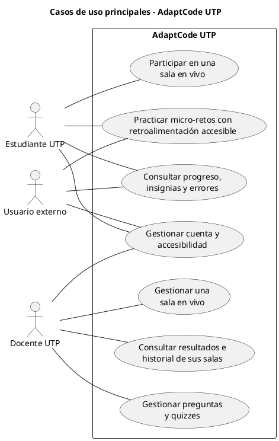

# AdaptCode UTP

## Documento maestro de contexto funcional y técnico

Fuente de referencia para análisis, diseño, desarrollo, documentación y conversaciones futuras del proyecto.

| Campo | Información |
|---|---|
| **Estado** | Alcance funcional del MVP confirmado por el equipo |
| **Fecha de corte** | 13 de septiembre de 2026 |
| **Institución** | Universidad Tecnológica del Perú |
| **Asignatura de referencia** | Herramientas de Desarrollo |
| **Sector** | EdTech - plataforma web educativa accesible y gamificada |

**Nombre vigente:** AdaptCode UTP. Los nombres anteriores KahootUTP y EduCode Inclusive se conservan solo como antecedentes históricos.

## Cómo usar este documento

Este PDF consolida la definición vigente de la aplicación. Cuando exista una contradicción con el informe APF1 original, prevalecen las decisiones confirmadas posteriormente por el equipo y registradas en este documento.

- **Fuente vigente principal:** requerimientos.docx, avance.docx y las 53 decisiones de diseño confirmadas por el equipo.
- **Fuente histórica:** Informe Técnico APF1. Se utiliza para antecedentes, integrantes, problema, arquitectura propuesta y planificación, pero no para reactivar funciones descartadas.
- El documento describe el MVP. Las funciones futuras se señalan expresamente como fuera de alcance.
- Las afirmaciones de investigación de campo del APF1 requieren conservar su evidencia original; este documento no las vuelve a validar ni inventa nuevos resultados.

## Tabla de contenido

- Cómo usar este documento 2
- Tabla de contenido 3
- 1 Resumen ejecutivo 5
  - 1.1 Modalidades 5
  - 1.2 Principios del producto 5
- 2 Identidad, problema y objetivos 5
  - 2.1 Problema que resuelve 5
  - 2.2 Objetivo general 5
  - 2.3 Objetivos específicos vigentes 5
- 3 Alcance del MVP y actores 6
  - 3.1 Dentro del alcance 6
  - 3.2 Fuera del alcance 6
- 4 Definición funcional vigente 6
  - 4.1 Registro, autenticación y perfiles 6
  - 4.2 Catálogo y práctica autónoma 7
  - 4.3 Retroalimentación y solución explicada 7
  - 4.4 Salas en vivo 7
  - 4.5 Reconexión y finalización 7
  - 4.6 Preguntas, quizzes y propiedad docente 8
- 5 Tiempo, puntuación, progreso y gamificación 8
  - 5.1 Temporizadores 8
  - 5.2 Puntuación y clasificación en vivo 8
  - 5.3 Progreso autónomo y puntos de dominio 8
  - 5.4 Insignias del MVP 9
- 6 Historial, analítica y privacidad 9
  - 6.1 Panel del estudiante 9
  - 6.2 Información disponible durante y después de una pregunta 9
  - 6.3 Historial de salas 9
  - 6.4 Conservación y control 9
- 7 Accesibilidad e inclusión 9
  - 7.1 Requisitos de interacción 10
  - 7.2 Preferencias 10
  - 7.3 Accesibilidad de gráficos y explicaciones 10
  - 7.4 Paleta de referencia 10
- 8 Requisitos no funcionales 10
- 9 Arquitectura y modelo de información propuestos 11
  - 9.1 Servicios lógicos sugeridos 11
  - 9.2 Entidades principales 12
- 10 Flujos principales de usuario 12
  - 10.1 Estudiante UTP en práctica autónoma 12
  - 10.2 Usuario externo 12
  - 10.3 Estudiante UTP en sala 12
  - 10.4 Docente 12
- 11 Diagrama de casos de uso principal 12
  - 11.1 Código PlantUML 13
- 12 Decisiones que reemplazan el APF1 inicial 14
- Anexo A Registro consolidado de decisiones Q1 a Q53 15
- Anexo B Antecedentes académicos y de proyecto 17
  - B.1 Integrantes registrados 17
  - B.2 Plan académico registrado 17
  - B.3 Control de versiones registrado 17
- Anexo C Fuentes consolidadas 18

# 1 Resumen ejecutivo

AdaptCode UTP es una plataforma web educativa para reforzar Algoritmos, Python y Bases de Datos mediante micro-retos con respuestas predefinidas, retroalimentación causal accesible, práctica autónoma y salas de clase en tiempo real. Su diferenciador no es premiar la rapidez, sino ayudar al estudiante a comprender por qué se equivocó y permitir una participación accesible.

## 1.1 Modalidades

| Modalidad | Propósito | Participantes |
|---|---|---|
| Práctica autónoma | Resolver micro-retos libremente por curso, tema y nivel, con reintentos y seguimiento formativo. | Estudiantes UTP y usuarios externos registrados. |
| Sala en vivo | Realizar una sesión síncrona dirigida por un docente, con PIN, temporizador, puntuación y analítica. | Docente UTP y estudiantes UTP autenticados. |

## 1.2 Principios del producto

- Aprendizaje formativo y no punitivo: el error genera explicación y oportunidad de reintento.
- Accesibilidad transversal: no se crea un actor separado para la discapacidad; todos pueden configurar preferencias.
- Precisión antes que velocidad: la rapidez solo desempata en una sala.
- MVP implementable: no ejecuta código real, no integra el ERP y no requiere panel administrativo.
- Privacidad por rol y propiedad: cada docente accede únicamente a sus salas y contenidos privados.

# 2 Identidad, problema y objetivos

La aplicación se dirige principalmente a estudiantes de primeros ciclos y docentes de carreras tecnológicas, con una ruta adicional para autodidactas externos.

## 2.1 Problema que resuelve

- Dificultad para pasar de la comprensión teórica a la aplicación práctica en programación y SQL.
- Retroalimentación insuficiente que solo indica que una respuesta es incorrecta.
- Conceptos abstractos difíciles de comprender sin una explicación secuencial del flujo.
- Competencias basadas en velocidad que pueden desplazar el aprendizaje real.
- Barreras de acceso por temporizadores rígidos, bajo contraste, dependencia del color y falta de compatibilidad con lectores de pantalla.
- Falta de información inmediata para que el docente detecte errores frecuentes de la clase.

## 2.2 Objetivo general

Desarrollar una plataforma web inclusiva y gamificada que mejore la comprensión de conceptos fundamentales de Algoritmos, Python y Bases de Datos mediante práctica autónoma y sesiones síncronas, retroalimentación explicativa y configuraciones accesibles.

## 2.3 Objetivos específicos vigentes

- Ofrecer micro-retos evaluables sin ejecución real de código.
- Explicar de forma causal los errores lógicos o sintácticos mediante texto y, cuando aporte valor, diagramas accesibles.
- Permitir al docente crear quizzes, dirigir salas y consultar resultados de sus propias sesiones.
- Cumplir WCAG 2.1 AA con operación por teclado, lectores de pantalla, contraste y redundancia visual.
- Conservar progreso, intentos, puntos, insignias y resultados personales.

# 3 Alcance del MVP y actores

El MVP trabaja con tres actores humanos. No incorpora un actor Administrador en la interfaz; el equipo carga los datos institucionales directamente.

| Actor | Acceso | Responsabilidades y límites |
|---|---|---|
| Estudiante UTP | Correo institucional verificado con patrón U + dígitos. | Practica, consulta su progreso y participa en salas. No puede ingresar tarde ni eliminar datos desde la interfaz. |
| Usuario externo | Correo convencional, contraseña y código de verificación. | Solo utiliza práctica autónoma y conserva progreso. No participa en salas en vivo. |
| Docente UTP | Correo institucional verificado con patrón C + dígitos. | Gestiona preguntas y quizzes, dirige salas y consulta únicamente la analítica de sus propias salas. |

## 3.1 Dentro del alcance

- Cursos institucionales: Algoritmos, Python y Bases de Datos.
- Práctica autónoma por curso, tema y niveles básico, intermedio y avanzado.
- Cuatro tipos de micro-retos con respuestas predefinidas.
- Retroalimentación causal y accesible para cada respuesta incorrecta.
- Salas en vivo con PIN numérico de seis dígitos, temporizador y control docente.
- Gestión de preguntas institucionales, copias privadas, preguntas propias y quizzes.
- Progreso, puntos de dominio, cinco insignias, historial de intentos y Errores por revisar.
- Analítica individual y grupal limitada por propiedad de la sala.

## 3.2 Fuera del alcance

- Compilador, editor o sandbox para ejecutar Python, SQL u otros lenguajes.
- Respuestas de texto libre y evaluación automática de código abierto.
- Panel administrativo para cuentas, sedes o catálogo institucional.
- Integración con SSO, ERP, matrícula o sistema de notas de la UTP.
- Usuarios externos en salas en vivo.
- Chat, foros, aplicaciones móviles nativas y narración de voz integrada.
- Rachas diarias, rankings autónomos o ranking global permanente.
- Programación de salas, recordatorios y sesiones recurrentes.
- Exportación de reportes a Excel o PDF desde la aplicación.
- Compartir preguntas privadas entre docentes.
- Eliminación de cuentas o datos por el estudiante.

# 4 Definición funcional vigente

Esta sección organiza las decisiones confirmadas como reglas implementables del producto.

## 4.1 Registro, autenticación y perfiles

- Una cuenta UTP se crea automáticamente después de verificar mediante código el correo institucional.
- El rol se asigna únicamente después de verificar el correo: U + uno o más dígitos + @utp.edu.pe corresponde a estudiante; C + uno o más dígitos + @utp.edu.pe corresponde a docente. Otros formatos institucionales se rechazan en el MVP.
- Después de la primera verificación, el usuario UTP define una contraseña para accesos posteriores.
- El usuario externo se registra con correo convencional, contraseña y código de verificación.
- El perfil mínimo solicita nombres, apellidos, contraseña y preferencias opcionales de accesibilidad. El correo queda asociado desde el registro y no se vuelve a solicitar como dato editable.
- La recuperación de contraseña utiliza un código numérico de seis dígitos, válido por diez minutos y de un solo uso. Al cambiarla se invalidan las sesiones anteriores.
- La recuperación siempre responde de forma neutral: Si el correo está registrado, recibirás un código. Se limitan los intentos de envío y validación.

## 4.2 Catálogo y práctica autónoma

- Todos los estudiantes UTP ven los tres cursos disponibles; no se afirma que representen su matrícula real.
- El usuario selecciona libremente curso, tema, nivel y micro-reto. El sistema registra progreso, pero no elige automáticamente el siguiente ejercicio.
- Niveles disponibles: básico, intermedio y avanzado.
- Tipos de reto: selección múltiple con una respuesta correcta, ordenamiento de bloques de código, predicción de salida de consola y selección del fragmento de código o consulta SQL correcta.
- El modo guiado sin tiempo es la opción predeterminada. El modo desafío personal permite 20, 30, 60, 90 o 120 segundos sin penalizar puntos ni progreso.
- Los reintentos son ilimitados y no restan puntos. Todos los intentos se conservan.

## 4.3 Retroalimentación y solución explicada

- En práctica autónoma, la retroalimentación aparece inmediatamente después de responder.
- Cada alternativa incorrecta debe incluir motivo específico del error, explicación conceptual, diagrama o secuencia textual, equivalente accesible y sugerencia para reintentar.
- Una pregunta no puede quedar Lista para usar ni utilizarse en una sala si alguna respuesta incorrecta carece de retroalimentación completa.
- Cuando un gráfico no aporta valor, puede sustituirse por una secuencia textual paso a paso.
- Después de un error no se revela inmediatamente la respuesta exacta. El estudiante revisa la explicación y vuelve a intentarlo.
- Al fallar tres veces el mismo reto se habilita Ver solución explicada. Si se utiliza, el reto queda resuelto con ayuda: cuenta para progreso y finalización del curso, pero no entrega el punto de dominio.

## 4.4 Salas en vivo

- El PIN es numérico, único, tiene seis dígitos y solo es válido durante la sesión activa.
- Solo pueden ingresar estudiantes UTP autenticados durante la sala de espera. Una vez iniciada la sesión, no se permite ingreso tardío.
- Cada cuenta ocupa un único lugar. El estudiante aparece con su identidad registrada y espera hasta que el docente inicie.
- Antes de iniciar, el docente puede expulsar participantes; la expulsión impide volver a esa sala salvo que el docente la revierta.
- Estados: Borrador, Sala de espera, En curso, Pausada y Finalizada.
- El docente controla el avance. La pausa congela el temporizador y no acepta respuestas.
- Cada pregunta tiene un único envío definitivo. Al seleccionar una alternativa, se envía inmediatamente, sin confirmación y sin posibilidad de cambio.
- El docente puede cerrar anticipadamente una pregunta. Si faltan respuestas, debe confirmar; las pendientes quedan omitidas.
- No se reabre una pregunta cerrada. Antes de finalizar la sala puede anularse, registrando el motivo; no entrega puntos ni afecta ranking o estadísticas.

## 4.5 Reconexión y finalización

- Si un estudiante pierde conexión, vuelve con la misma cuenta y no se duplica.
- Una respuesta ya enviada permanece. Si la pregunta sigue abierta, puede responder con el tiempo restante; si cerró, queda omitida.
- La reconexión no reinicia el temporizador ni concede tiempo adicional.
- El docente puede finalizar anticipadamente la sala con confirmación. La pregunta abierta se cierra, las pendientes quedan omitidas y se genera un informe parcial.
- Pregunta no respondida y pregunta omitida representan el mismo estado funcional.

## 4.6 Preguntas, quizzes y propiedad docente

- Pregunta institucional: cargada por el equipo, disponible para todos los docentes y no modificable ni eliminable desde la aplicación.
- Copia del docente: se genera al clonar una pregunta institucional y puede editarse o eliminarse por su creador.
- Pregunta propia: creada por el docente y privada para él; otros docentes no pueden verla ni modificarla.
- Quiz: selección ordenada de preguntas institucionales, clonadas o propias.
- Estados del quiz: Borrador y Listo para usar. No existe un estado público denominado Publicado.
- Antes de crear la sala se configura tiempo y accesibilidad. Al iniciar, se guarda una copia inmutable del quiz para que cambios posteriores no alteren el historial.
- El catálogo institucional del MVP es fijo y se carga mediante una actualización controlada por el equipo, no desde la interfaz docente.

# 5 Tiempo, puntuación, progreso y gamificación

La gamificación diferencia el dominio autónomo de la competencia temporal en una sala, evitando premiar la repetición o convertir la velocidad en el objetivo principal.

## 5.1 Temporizadores

| Contexto | Valores | Regla |
|---|---|---|
| Sala en vivo | 20, 30, 60, 90 o 120 segundos | Siempre tiene temporizador. El docente define el tiempo por pregunta. |
| Accesibilidad ampliada | Estándar, +50 % o +100 % | Se aplica a toda la sala y se configura antes de iniciar. |
| Práctica autónoma | Sin tiempo o 20, 30, 60, 90 o 120 segundos | El tiempo es de autoevaluación y no cambia puntos ni progreso. |

## 5.2 Puntuación y clasificación en vivo

- Cada respuesta correcta vale un punto; una incorrecta u omitida vale cero.
- El tiempo acumulado solo se utiliza para desempatar entre estudiantes con la misma cantidad de aciertos.
- Si también empatan en tiempo, comparten la posición. La siguiente posición se salta: 1, 1, 3.
- La clasificación se limita a la sala activa o terminada.
- Los estudiantes ven nombre y primera letra del apellido; el docente de la sala ve la identidad completa.

## 5.3 Progreso autónomo y puntos de dominio

- El progreso se calcula sobre micro-retos institucionales únicos completados, no sobre el número de intentos.
- Cada micro-reto entrega como máximo un punto de dominio, únicamente la primera vez que se resuelve correctamente sin usar la solución explicada.
- Repetir un reto no genera puntos adicionales, aunque los intentos permanecen en el historial.
- Se conserva: total de intentos, resultado inicial y final, fecha, tiempo, curso, tema, nivel y errores cometidos.
- Un curso se completa al resolver todos los micro-retos institucionales del curso, en todos sus temas y niveles. Los resueltos con ayuda cuentan para completarlo, aunque no entregan punto de dominio.

## 5.4 Insignias del MVP

| Insignia | Condición |
|---|---|
| Primer paso | Completar el primer micro-reto. |
| Explorador | Completar al menos un reto de cada curso. |
| Dominio básico | Completar todos los retos básicos de un tema. |
| Perseverante | Resolver correctamente un reto después de tres o más intentos. |
| Curso completado | Completar todos los micro-retos institucionales de un curso. |

Cada insignia se obtiene una sola vez, no se retira y no concede ventajas competitivas.

# 6 Historial, analítica y privacidad

El sistema conserva datos para mostrar aprendizaje y resultados, pero limita estrictamente su visibilidad.

## 6.1 Panel del estudiante

- Progreso por curso, tema y nivel.
- Puntos de dominio e insignias.
- Micro-retos completados y pendientes.
- Errores por revisar: todo intento incorrecto se agrega automáticamente; al resolver el reto se mantiene en el historial y se marca como superado.
- Historial completo de intentos y resultados personales de salas.
- Nunca muestra progreso, errores ni resultados ajenos fuera de la tabla de posiciones de una sala.

## 6.2 Información disponible durante y después de una pregunta

| Momento | Estudiante | Docente creador |
|---|---|---|
| Pregunta abierta | Enunciado, alternativas y estado de su propio envío. | Quién respondió y quién falta; no ve la alternativa elegida. |
| Pregunta cerrada | Respuesta propia, solución correcta, explicación, representación accesible, punto y posición provisional. | Respuestas individuales, distribución, porcentaje de aciertos, omitidas y errores frecuentes. |

## 6.3 Historial de salas

- Docente creador, quiz y copia de las preguntas utilizadas.
- Fecha, duración, participantes y resultados.
- Respuestas correctas, incorrectas y omitidas; tiempos, puntos y posición final.
- Preguntas anuladas y motivo.
- Resumen grupal, distribución y mapa de errores frecuentes.
- Consulta dentro de AdaptCode UTP; sin exportación a Excel o PDF en el MVP.

## 6.4 Conservación y control

- El docente consulta información individual y grupal únicamente de las salas que creó.
- El estudiante solo consulta sus propios datos.
- La cuenta, progreso, intentos y resultados se conservan mientras la cuenta permanezca activa.
- El estudiante no puede borrar datos, progreso ni cuenta, ni solicitar su eliminación dentro del alcance definido.

# 7 Accesibilidad e inclusión

La meta no es una experiencia separada, sino una interfaz común que pueda adaptarse sin revelar condiciones personales.

## 7.1 Requisitos de interacción

- Cumplimiento objetivo de WCAG 2.1 nivel AA.
- Navegación completa mediante teclado, foco visible y orden lógico.
- Etiquetas semánticas y ARIA apropiadas para controles y actualizaciones dinámicas.
- Compatibilidad completa con lectores de pantalla externos; no habrá narración integrada en el MVP.
- Ninguna explicación depende únicamente del color, flechas o audio.
- Texto normal con contraste mínimo 4.5:1 y elementos de interfaz con contraste mínimo 3:1.
- Si en el futuro existe audio, deberá incluir equivalente textual, subtítulos o alerta visual.

## 7.2 Preferencias

- Tema normal o alto contraste.
- Tamaño de texto.
- Reducción de movimiento.
- Preferencias de sonido.
- Modo de daltonismo cuando se mantengan paletas especializadas.
- Antes de iniciar sesión, tema, contraste, tamaño y reducción de movimiento se guardan localmente. Después del acceso se aplican automáticamente las preferencias persistidas en la cuenta.
- El tiempo ampliado no es una preferencia personal pública: es una configuración de toda la sala definida por el docente.

## 7.3 Accesibilidad de gráficos y explicaciones

- Cada gráfico lleva título descriptivo.
- Incluye una descripción textual paso a paso equivalente al recorrido visual.
- Su estructura y orden de lectura deben ser comprensibles con lector de pantalla.
- Color, forma, texto e iconos se combinan para comunicar el estado.

## 7.4 Paleta de referencia

| Uso | Color | Código | Regla |
|---|---|---|---|
| Fondo oscuro | Azul marino | #0F172A | Base de alto contraste. |
| Acción y foco | Azul | #2563EB / #38BDF8 | Botones y foco visible. |
| Acierto | Verde | #15803D | Siempre acompañado de texto o icono. |
| Advertencia | Ámbar | #D97706 | Temporizador y sugerencias. |
| Error | Rojo | #DC2626 | Siempre acompañado de explicación e icono. |

# 8 Requisitos no funcionales

Los siguientes objetivos provienen de la definición de requisitos del equipo y deben verificarse mediante pruebas específicas.

| Área | Requisito | Criterio |
|---|---|---|
| Accesibilidad | WCAG 2.1 AA, teclado, lectores de pantalla, ARIA y redundancia cromática. | Auditoría automática y revisión manual de recorridos críticos. |
| Tiempo real | Sincronización de inicio, respuestas y cierre. | Latencia objetivo no mayor a 500 ms con al menos 60 usuarios simultáneos. |
| Rendimiento | Carga de vistas principales. | Objetivo no mayor a 2.5 s en redes estándar; experiencia fluida en escritorio y móvil. |
| Seguridad | Contraseñas, sesiones y autorización. | Hash robusto, JWT con expiración, invalidación tras recuperación y aislamiento por roles. |
| Privacidad | Resultados y contenido docente. | Acceso según propietario y rol; evitar enumeración de cuentas. |
| Integridad | Historial de salas y quizzes. | Instantánea inmutable del quiz y registros de anulación con motivo. |

# 9 Arquitectura y modelo de información propuestos

La arquitectura consignada por el equipo combina Angular, Spring Boot y Supabase sobre PostgreSQL. Esta selección se considera una propuesta técnica vigente, sujeta a validación durante la implementación.

| Capa | Tecnología | Responsabilidad |
|---|---|---|
| Frontend | Angular y TypeScript | SPA responsiva, componentes accesibles, formularios, estado de sala y paneles. |
| Estilos | Tailwind CSS y variables CSS | Temas, alto contraste, foco y paletas adaptables. |
| Backend | Java y Spring Boot 4 | API REST, reglas de negocio, autorización y evaluación de respuestas. |
| Seguridad | Spring Security, JWT y hash de contraseñas | Autenticación, sesiones y control por roles. |
| Datos | Supabase y PostgreSQL | Persistencia relacional y sincronización en tiempo real. |
| Calidad | Axe-core y Lighthouse | Apoyo a auditorías de accesibilidad y rendimiento. |

## 9.1 Servicios lógicos sugeridos

- AuthService: verificación de correo, cuentas, contraseñas, recuperación y JWT.
- CatalogService: cursos, temas, niveles y micro-retos institucionales.
- EvaluationService: valida respuestas predefinidas y entrega retroalimentación.
- ProgressService: intentos, dominio, progreso, errores e insignias.
- QuizService: preguntas institucionales, copias, preguntas propias y quizzes.
- LiveRoomService: PIN, participantes, estados, temporizadores, respuestas y reconexión.
- AnalyticsService: resultados personales, informes de sala y errores frecuentes.
- AccessibilityPreferenceService: preferencias persistidas por cuenta.

## 9.2 Entidades principales

| Entidad | Datos esenciales |
|---|---|
| Usuario | Correo, nombres, apellidos, rol, contraseña hash, estado y nombre visible. |
| PreferenciaAccesibilidad | Tema, contraste, tamaño, movimiento, sonido y modo cromático. |
| Curso / Tema / Nivel | Estructura fija del catálogo institucional. |
| MicroReto | Tipo, enunciado, alternativas o bloques, respuesta correcta, curso, tema y nivel. |
| Retroalimentación | Alternativa incorrecta, causa, concepto, gráfico o secuencia, descripción y sugerencia. |
| Intento | Usuario, reto, respuesta, resultado, tiempo, fecha, número de intento y uso de ayuda. |
| Progreso / Insignia | Reto completado, punto de dominio, resuelto con ayuda e insignias obtenidas. |
| PreguntaDocente / Quiz | Propietario, origen institucional, estado, orden, configuración y versión. |
| Sala | Docente, PIN, estado, quiz congelado, tiempos, accesibilidad y fechas. |
| Participación / RespuestaSala | Estudiante, expulsión, respuesta, tiempo, resultado, omisión, puntaje y posición. |
| AnulaciónPregunta | Pregunta, docente, motivo y fecha. |

# 10 Flujos principales de usuario

Los flujos resumen el comportamiento esperado sin sustituir las validaciones detalladas de cada pantalla.

## 10.1 Estudiante UTP en práctica autónoma

Verifica su correo y crea la cuenta → completa el perfil → inicia sesión → selecciona curso, tema y nivel → elige modo guiado o desafío personal → responde un micro-reto → recibe retroalimentación → reintenta si falla → consulta progreso, insignias y Errores por revisar.

## 10.2 Usuario externo

Registra correo convencional y contraseña → verifica el código → completa el perfil → inicia sesión → accede únicamente a la práctica autónoma → conserva progreso e historial.

## 10.3 Estudiante UTP en sala

Inicia sesión → introduce PIN durante la sala de espera → espera al docente → responde con un único toque → espera el cierre → consulta su resultado, explicación y posición → continúa con la pregunta siguiente → revisa su resultado personal al finalizar.

## 10.4 Docente

Inicia sesión → prepara un quiz con preguntas institucionales, clonadas o propias → completa la retroalimentación → marca el quiz Listo para usar → crea la sala → configura tiempos y accesibilidad → admite o expulsa participantes → inicia y controla preguntas → revisa resultados tras cada cierre → finaliza y consulta el historial de su sala.

# 11 Diagrama de casos de uso principal

El diagrama mantiene únicamente los objetivos principales de cada actor. La verificación por correo es un mecanismo interno de acceso y no se muestra como actor en este nivel.

## Figura 1. Casos de uso principales de AdaptCode UTP.

- **Estudiante UTP**
  - Gestionar cuenta y accesibilidad
  - Practicar micro-retos con retroalimentación accesible
  - Consultar progreso, insignias y errores
  - Participar en una sala en vivo
- **Usuario externo**
  - Gestionar cuenta y accesibilidad
  - Practicar micro-retos con retroalimentación accesible
  - Consultar progreso, insignias y errores
- **Docente UTP**
  - Gestionar cuenta y accesibilidad
  - Gestionar preguntas y quizzes
  - Gestionar una sala en vivo
  - Consultar resultados e historial de sus salas

## 11.1 Código PlantUML

# 12 Decisiones que reemplazan el APF1 inicial

El informe APF1 contiene conceptos que ya no corresponden al MVP. Esta tabla evita que futuras conversaciones los traten como requisitos activos.

| Idea anterior | Definición vigente |
|---|---|
| Nombre EduCode Inclusive o KahootUTP | Nombre definitivo: AdaptCode UTP. |
| Actores especiales para discapacidad o competencia | La accesibilidad es transversal; existen solo Estudiante UTP, Usuario externo y Docente UTP. |
| Docente y administrador como un solo actor | El docente no administra usuarios ni catálogo central; no hay panel administrativo en el MVP. |
| Adaptación automática del ejercicio | Selección libre de curso, tema, nivel y reto. |
| Editor o ejecución de código | Solo cuatro tipos de respuesta predefinida. |
| Narración o Web Speech API | Compatibilidad con lectores de pantalla externos, sin narración integrada. |
| Pistas ilimitadas y respuesta revelada | Explicación sin revelar la solución; tras tres fallos puede verse la solución explicada y se marca resuelto con ayuda. |
| Rachas y rankings autónomos | Solo progreso, puntos e insignias; ranking limitado a la sala. |
| Accesibilidad AA y AAA | Objetivo definido: WCAG 2.1 AA. |
| PIN alfanumérico | PIN numérico de seis dígitos. |
| Retroalimentación en vivo inmediata | Se revela después de cerrar la pregunta. |
| Ingreso tardío | No se permite una vez iniciada la sesión. |

# Anexo A Registro consolidado de decisiones Q1 a Q53

Este registro conserva la trazabilidad de las decisiones acordadas. Su redacción está normalizada para implementación.

| N.º | Tema | Decisión vigente |
|---:|---|---|
| 1 | Cuenta UTP | Correo institucional, código de verificación y creación automática de cuenta. |
| 2 | Administración | Sin panel administrativo; cursos y preguntas institucionales se precargan por el equipo. |
| 3 | Evaluación | Respuestas predefinidas; no se ejecuta código real. |
| 4 | Tiempo accesible | Modo estándar, +50 % o +100 % aplicado a toda la sala. |
| 5 | Feedback en vivo | Se muestra cuando se cierra la pregunta; en práctica se muestra inmediatamente. |
| 6 | PIN | Seis dígitos numéricos. |
| 7 | Cursos | Algoritmos, Python y Bases de Datos visibles para estudiantes UTP. |
| 8 | Rol institucional | Correo verificado U + dígitos = estudiante; C + dígitos = docente. |
| 9 | Usuario externo | Correo convencional, contraseña y código; conserva progreso. |
| 10 | Propiedad de preguntas | Institucional inmutable; copia y pregunta propia privadas y editables por el docente. |
| 11 | Progresión | Selección libre de curso, tema y nivel básico, intermedio o avanzado. |
| 12 | Gráficos accesibles | Título, descripción paso a paso y lectura estructurada; no depender de color, flechas o audio. |
| 13 | Puntuación en sala | Un punto por acierto; tiempo acumulado solo como desempate. |
| 14 | Accesos posteriores | La cuenta UTP define contraseña después de la primera verificación. |
| 15 | Patrón UTP | No se fija la cantidad de dígitos; siempre se verifica el código enviado. |
| 16 | Externo en sala | No permitido; el externo solo practica autónomamente. |
| 17 | Ciclo de sala | Borrador, espera, curso, pausa y finalizada; cierre anticipado con confirmación si hay pendientes. |
| 18 | Reintentos | Ilimitados, sin pérdida de puntos y con registro de todos los intentos. |
| 19 | Feedback obligatorio | No se usa una pregunta si una opción incorrecta no tiene retroalimentación completa. |
| 20 | Preferencias | Persisten en la cuenta y se aplican automáticamente. |
| 21 | Ingreso y expulsión | Un lugar por cuenta; expulsión solo antes de iniciar y reversible por el docente. |
| 22 | Envío | Un envío definitivo por pregunta; seleccionar una opción envía sin confirmación. |
| 23 | Reconexión | Mantiene respuesta y tiempo; no duplica, reinicia ni permite repetir preguntas cerradas. |
| 24 | Resultados | Solución y distribución solo después del cierre; no respondida equivale a omitida. |
| 25 | Cálculo de progreso | Se calcula con micro-retos únicos completados; conserva primer y último resultado e intentos. |
| 26 | Gamificación | Progreso, puntos e insignias; sin racha ni rankings autónomos. |
| 27 | Recuperación | Código de seis dígitos, 10 minutos, un uso, sesiones invalidadas y mensaje neutral. |
| 28 | Quiz | Estados Borrador y Listo para usar; se congela una copia al iniciar la sala. |
| 29 | Tiempo por pregunta | 20, 30, 60, 90 o 120 segundos; sala siempre temporizada. |
| 30 | Pregunta cerrada | No se reabre; puede anularse antes de finalizar, con motivo y sin efecto estadístico. |
| 31 | Analítica docente | Solo salas propias; durante la pregunta ve quién respondió, no la alternativa. |
| 32 | Historial de sala | Se conserva en la aplicación; sin exportación Excel o PDF. |
| 33 | Punto de dominio | Un punto por reto distinto dominado; repetir no acumula puntos. |
| 34 | Insignias | Cinco insignias únicas y sin ventajas competitivas. |
| 35 | Errores por revisar | Todo error se guarda; al superar el reto permanece marcado como superado. |
| 36 | Privacidad docente | Preguntas propias privadas; todos usan las institucionales. |
| 37 | Tipos de reto | Selección múltiple, ordenar bloques, predecir salida y elegir SQL o código correcto. |
| 38 | Tiempo autónomo | Guiado sin tiempo o desafío personal temporizado sin penalización. |
| 39 | Curso completado | Todos los micro-retos institucionales de todos los temas y niveles del curso. |
| 40 | Accesibilidad pública | Tema, contraste, tamaño y movimiento antes del login; tiempo ampliado solo desde la sala. |
| 41 | Lectores de pantalla | Compatibilidad externa completa; sin narración integrada. |
| 42 | Identidad visible | Nombre e inicial del apellido para estudiantes; identidad completa para el docente de la sala. |
| 43 | Creación de salas | Solo en el momento de la clase; sin programación futura. |
| 44 | Eliminación | El estudiante no elimina datos desde la interfaz. |
| 45 | Perfil mínimo | Nombres, apellidos, contraseña y accesibilidad opcional; correo ya asociado y no editable. |
| 46 | Ingreso tardío | No se permite después de iniciar la sesión. |
| 47 | Ver solución | Tras tres fallos; marca resuelto con ayuda y no entrega punto de dominio. |
| 48 | Fin anticipado | Confirmación, cierre de pregunta, pendientes omitidas e informe parcial. |
| 49 | Empate total | Comparten posición y se salta la siguiente: 1, 1, 3. |
| 50 | Panel personal | Progreso, puntos, insignias, pendientes, errores, intentos y resultados propios. |
| 51 | Conservación | Datos mientras la cuenta esté activa; no se contempla eliminación solicitada por el estudiante. |
| 52 | Resuelto con ayuda | Cuenta para progreso y finalización, pero no para punto de dominio. |
| 53 | Catálogo de progreso | Solo catálogo institucional fijo cargado por el equipo. |

# Anexo B Antecedentes académicos y de proyecto

La siguiente información se conserva como referencia del informe APF1 y debe actualizarse si el equipo modifica integrantes, repositorio o cronograma.

## B.1 Integrantes registrados

- Ever Aaron Rosado Castillo
- Johan Anderson Castillon Ruiz
- Jimmy Moises Garcia Cortez
- Alexander Rosas Cardenas Egusquiza
- Gabriel Aquil Alva Tito
- Willy Antonio Leon Perez

## B.2 Plan académico registrado

| Hito | Semana |
|---|---:|
| APF1 | 6 |
| APF2 | 11 |
| APF3 | 15 |
| Proyecto final | 18 |

## B.3 Control de versiones registrado

- main: entregables estables.
- develop: integración del trabajo validado.
- feature/*: ramas por funcionalidad.
- Repositorio consignado en el APF1: https://github.com/Johan409IA/kohoot-utp. Se recomienda comprobar que siga siendo la URL vigente.

# Anexo C Fuentes consolidadas

El contenido se construyó a partir de las fuentes entregadas por el equipo y de las decisiones confirmadas en la conversación de definición funcional.

| Fuente | Uso |
|---|---|
| requerimientos.docx | Reglas de negocio, funciones, no funcionales, alcance y flujos iniciales. |
| avance.docx | Identidad AdaptCode UTP, problema, objetivos, accesibilidad y arquitectura propuesta. |
| Entrevista de decisiones Q1 a Q53 | Resolución de ambigüedades y definición final del MVP. |
| Informe Técnico APF1 | Antecedentes del proyecto, integrantes, problema, stack, planificación y repositorio; sus contradicciones se consideran reemplazadas. |

**Fin del documento**
